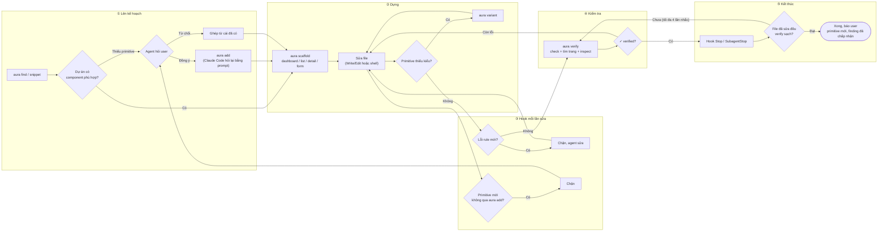

# Aura UI (v1.5)

Plugin/skill giúp coding agent làm UI không bị "AI slop", theo cách Lovable làm: **stack cố định,
starter cài sẵn đủ component, design system viết trước, màn hình chỉ được ghép từ component có sẵn**.
Bổ sung thêm những gì Lovable thiếu cho app nội bộ và dashboard: tiết chế ở màn hình công cụ, màu dùng
cho dữ liệu, bố cục dashboard theo dải, định dạng vi-VN, tự kiểm tra ở 390/768/1440.

## Kết quả eval (chấm mù, cùng model)
| Đề | Không skill | Aura UI |
|---|---|---|
| Dashboard phòng khám | 2,2 | **2,7** |
| Dashboard bán hàng | 2,2 | **2,6** |
| Dashboard CSKH (đề giữ riêng, không dùng để viết luật) | 1,9 | **2,6** |

Thang 0–3, ship-quality ≥ 2,6. Chi tiết từng vòng trong `evals/results/v3`→`v6`
(ở các vòng này skill còn tên `aura-base`).

## Cấu trúc
```
.claude-plugin/              plugin.json, marketplace.json
hooks/hooks.json             hook cho agent: SessionStart, PostToolUse (Write|Edit, Bash), Stop
skills/                      10 skill, gọi bằng /aura-ui:<tên>
  build/                     dựng/sửa màn hình theo luật thiết kế (tự kích hoạt khi làm UI)
  setup/                     kiểm tra máy (Node, npm, git, Claude CLI, Playwright), đề xuất cách cài
  init/  scan/               cài aura vào repo · quét lại, trạng thái, baseline
  find/  check/  describe/   tìm component · kiểm tra & sửa lỗi · viết mô tả component
  inspect/                   aura verify trước khi xong việc; mở trang đã dựng, báo lỗi bố cục / màu / số liệu bằng chữ
  studio/                    mở Aura Studio: trang chat + preview live kiểu Lovable
  new-app/                   tạo app từ starter (add-on editor/lightbox: aura find in sẵn lệnh cài khi cần)
manager/                     Aura component manager: aura.mjs (init, find, snippet, add, scaffold, variant,
                             show, usage, tokens, check, verify, inspect, studio, describe, baseline, scan, status, hook);
                             studio.mjs + studio.html (trang Aura Studio)
template/                    starter: Vite + React 19 + TS + Tailwind v4 + shadcn (63 component, Base UI),
                             blocks/ (page-header, stat, data-table, form…), lib/format.ts, token
catalog/components.json      danh mục 76 mục của starter (dùng làm từ điển Việt–Anh cho aura find)
addons/                      rich-text-editor (Tiptap), file-lightbox (PDF/Word/Excel/ảnh)
scripts/                     smoke.mjs (test end-to-end, CI chạy trên 3 hệ điều hành), find-node.sh|ps1 (tìm Node ngoài PATH), install-node.sh|ps1 (cài Node không cần admin), new-app.sh, add-block.mjs, catalog.mjs
references/                  design-system.md, dashboard.md
evals/                       quy trình A/B, baseline project, công cụ audit/critic, kết quả v3–v6
```

## Cài đặt
**Claude Desktop (tab Code) hoặc Claude Code CLI:**
```
/plugin marketplace add haringuyendev/aura-ui
/plugin install aura-ui@aura-ui
/aura-ui:setup
```
Trong Claude Desktop có thể cài ở **Customize → Plugins → Add marketplace**, hoặc trong tab **Code**: **+ → Add plugins**.
CLI và phiên local của Desktop đọc chung cấu hình, nên cài ở một chỗ là chỗ kia cũng có.

**Không cần biết Node.js:** `/aura-ui:setup` kiểm tra máy. Nếu chưa có Node, skill hỏi một câu rồi tự cài bản LTS chính
thức từ nodejs.org (có kiểm checksum), vào thư mục riêng của user (`~/.aura-ui/node`, trên Windows là
`%LOCALAPPDATA%\aura-ui\node`). Không cần quyền admin. Sau đó người dùng **thoát hẳn Claude Desktop rồi mở lại** (CLI: mở
terminal mới). Các skill khác gặp lỗi thiếu `node` cũng tự chuyển sang `setup`. Trước khi cài xong, hook của aura báo lỗi
"node: command not found" mỗi lần sửa file; lỗi này không chặn gì, cài xong và khởi động lại là hết.

| | Để làm gì | Ai cài |
|---|---|---|
| Node.js ≥ 20 | CLI aura, hook kiểm tra, Studio, dev server của app | `/aura-ui:setup` tự cài |
| Claude Code CLI | Aura Studio gọi `claude -p` (Desktop không cho gọi bản bên trong nó) | `/aura-ui:setup` đề xuất lệnh cài chính thức |
| git | `aura verify` biết file nào đã đổi; lịch sử của app mới | tùy chọn |
| Playwright + Chromium | `aura verify` mở trang để kiểm tra | tùy chọn, Studio có nút cài |

Tab chat thường của Desktop và claude.ai chạy trong sandbox trên cloud: skill hiện ra nhưng hook và lệnh local không chạy.
Hãy dùng tab **Code**.

**Thử nhanh:** trong repo có `.aura/`, bảo agent viết một `<button>` thô trong một page. Thấy "Aura blocked this change" là
hook đang chạy. CI (`.github/workflows/smoke.yml`) chạy `scripts/smoke.mjs` và thử script cài Node trên macOS, Linux và Windows.

**Agent khác** (Codex, Cursor, Gemini CLI, OpenCode… loại đọc được thư mục skill có `SKILL.md`):
clone repo rồi copy hoặc symlink các thư mục trong `skills/` vào thư mục skill của agent đó (các skill trỏ
ngược về thư mục plugin qua `../..`, nên giữ nguyên cấu trúc repo), ví dụ:
```bash
git clone https://github.com/haringuyendev/aura-ui.git
for s in aura-ui/skills/*; do ln -s "$PWD/$s" ~/.codex/skills/aura-ui-$(basename $s); done   # Codex
```
Agent không hỗ trợ skill: thêm vào `AGENTS.md` của project một dòng "Khi làm UI, đọc và làm theo
`<đường-dẫn>/skills/build/SKILL.md`". Hook chỉ có trên Claude Code; agent khác chạy `node .aura/bin/aura.mjs check --changed` trước khi xong việc.
Skill `build` tự kích hoạt khi làm hoặc sửa màn hình; các skill khác gọi bằng `/aura-ui:init`, `/aura-ui:find`, `/aura-ui:check`…
Tạo app mới từ starter: `node manager/aura.mjs new <thư-mục>` (hoặc `/aura-ui:new-app`, hoặc Aura Studio ở thư mục trống).

## Đổi design system
Màu, font, bo góc, shadow, bảng màu biểu đồ nằm trong `src/index.css` của app. Vì màn hình chỉ dùng
token và component của template, sửa file này là cả app đổi theo (đã thử trên dashboard phòng khám:
11 dòng token, không sửa code màn hình). Hình dáng component sửa trong `src/components/ui/`.

## Thêm hoặc sửa component
1. Thêm file vào `template/src/components/ui/` (ví dụ `npx shadcn add <tên>` trong template)
   hoặc khối tự viết vào `template/src/components/blocks/` (chỉ ghép từ `ui/`, dùng token).
2. Thêm một mục vào `catalog/components.json` (name, category, summary, use_when,
   avoid_when, keywords có cả tiếng Việt, example, related).
3. Chạy `node scripts/catalog.mjs sync`: tự cập nhật exports/variants từ code, báo mục
   còn thiếu hoặc thừa.

## Workflow

Agent dựng từ linh kiện của dự án, hook chặn ngay khi lệch luật, và không được kết thúc khi `aura verify` chưa sạch.
Sau 4 lần nhắc mà vẫn chưa đạt, agent được dừng nhưng user nhận thông báo những gì còn tồn đọng.

## Aura Studio
Trang kiểu Lovable chạy local cho dự án đã có `.aura/`:
```bash
node .aura/bin/aura.mjs studio          # http://localhost:4400 (--app apps/web, --port, --model, --no-open)
```
- Bên trái là khung chat. Mỗi tin nhắn chạy `claude -p` ngay trong repo, dùng đăng nhập Claude Code của máy, nên skill và hook của
  aura (check, verify, chặn primitive tự dựng) áp dụng y như khi làm trong terminal. Câu trả lời hiện dần, các bước làm gom thành
  danh sách thu gọn được, lời nhắc của hook Aura hiện thành ghi chú.
- Bên phải là dev server của app với các khung Vừa khung/1440/768/390. Nếu dev server chưa chạy, Studio đề nghị bật giúp.
  Trang tự cập nhật qua HMR và tải lại khi agent làm xong.
- Agent muốn thêm primitive mới thì Studio hiện nút **Đồng ý / Không**, thay cho prompt quyền của terminal.
- Dự án chưa có Playwright thì agent verify với `--skip-inspect`, còn Studio hiện nút cài Playwright cho user.
- App mới hoàn toàn: chạy Studio ở thư mục trống, hoặc thêm `--new <tên>`. Trang mở bằng màn hình "Mô tả app anh muốn dựng".
  Studio tạo app từ starter (cài thư viện, `aura init`, `git init`), bật dev server, rồi gửi mô tả làm tin nhắn đầu để agent
  dựng màn hình đầu tiên.
- Đính kèm file vào tin nhắn: bấm 📎, kéo thả vào khung chat hoặc dán ảnh chụp màn hình; màn hình tạo app cũng đính kèm được.
  File lưu ở `.aura/cache/studio-uploads/` (không vào git). Agent đọc ảnh như mockup hoặc ảnh chụp lỗi, CSV/JSON như dữ liệu mẫu,
  PDF/text như tài liệu yêu cầu, còn Excel/Word thì đọc qua skill xlsx/docx.
- Chỉ nghe trên 127.0.0.1 và chặn request từ trang khác (kiểm tra Host và Origin).

## Aura component manager
Aura quản lý component của chính dự án: registry `.aura/` luôn khớp với code nhờ hook của agent.
```bash
node manager/aura.mjs init                       # trong repo dự án (monorepo: ở thư mục gốc): quét, tạo .aura/; --scripts để thêm script npm
node .aura/bin/aura.mjs find "ô nhập liệu"       # component phù hợp; thiếu primitive thì in lệnh cài (sau khi hỏi user)
node .aura/bin/aura.mjs snippet Item             # dòng import, variant và cách dùng thật trong code
node .aura/bin/aura.mjs add calendar popover     # cài primitive bằng shadcn (đúng package manager, đúng thư mục) rồi đăng ký
node .aura/bin/aura.mjs scaffold dashboard src/pages/orders.tsx   # khung trang dựng từ component của dự án
node .aura/bin/aura.mjs variant Item critical --write             # thêm variant cva cho primitive thay vì tô div
node .aura/bin/aura.mjs verify                   # check file đã đổi + inspect các trang hiển thị chúng; hook Stop đòi lệnh này
node .aura/bin/aura.mjs show Button              # props, variant, mô tả, đường import, nơi đang dùng
node .aura/bin/aura.mjs tokens                   # màu, font, token trạng thái (cái nào dùng làm chữ được)
node .aura/bin/aura.mjs check --changed          # kiểm tra file đã đổi (dùng cho pre-commit/CI)
node .aura/bin/aura.mjs stats                    # số finding theo rule: mới / có sẵn
node .aura/bin/aura.mjs doctor                   # Aura chưa nhận ra gì ở repo này, sửa bằng key nào
node .aura/bin/aura.mjs inspect http://localhost:5173 /orders   # xem một trang đã render ở 1440/768/390, báo lỗi bằng chữ
node .aura/bin/aura.mjs describe --from mo-ta.json   # mô tả nhiều component một lần
```

**Kiểm tra trước khi xong việc** (`aura verify`, cần dev server và Playwright trong dự án): lấy các file giao diện đã
đổi (git và các phiên agent gần đây, kể cả file sửa bằng lệnh shell), check từng file, rồi lần theo import và router
(file route của Next/Remix/TanStack, `<Route path element>` của React Router kèm hằng `ROUTES.X`) để tìm trang hiển
thị chúng. Mỗi app được dò dev server riêng, tối đa 6 trang phủ hết các file. Kết quả được lưu theo từng file, nên
sửa lại file sau khi verify thì phải verify lại. `inspect` mở trang headless ở 1440/768/390, in dàn ý trang và báo
bằng chữ: tràn ngang, chồng lấn, chữ bị cắt, thẻ cao lệch; số KPI chưa nổi bật hoặc đang báo "quá hạn" mà vẫn xám;
trạng thái cùng một màu xám; tương phản dưới WCAG AA; tỉ lệ nội dung có màu quá thấp; cùng một thông tin lặp ở nhiều
khối; nhiều nút primary, nút Xóa/Hủy không có màu destructive, nút trông như bị tắt. Finding sai với trang thì
`--accept <rule> --reason "…"`, trang không mở được thì `--skip-inspect "…"`; cả hai đều được báo cho user và ghi vào
`.aura/cache/feedback.jsonl` để chỉnh ngưỡng. Ngưỡng và mức độ chỉnh trong `.aura/rules.json` (`"inspect": {…}`,
`"verify": { "mode": "required" | "off", "maxPages", "maxStopBlocks" }`).

**Quản lý primitive:** registry chỉ chứa primitive và block dùng chung. Thiếu primitive thì `find` báo
`MISSING PRIMITIVE` kèm lệnh; agent phải hỏi user, rồi cài bằng `aura add` (hook PreToolUse hiện prompt xin phép cho
`aura add`/`shadcn add` và cho file mới ghi vào thư mục primitive). File primitive xuất hiện qua lệnh shell khác bị
chặn; cuối phiên user được báo các primitive mới.

**Monorepo** (Turborepo, Nx, pnpm/bun/yarn workspaces): init ở thư mục gốc. Một `.aura/` quản lý mọi app và
package; package có `components.json` (vd. `packages/ui`) là nguồn primitive; hiểu alias tsconfig, `#imports`
của package.json và `exports` của workspace package; đếm lượt dùng trên toàn bộ app; in đường import công khai
(`@acme/ui/components/button`) kèm đường nội bộ (`#components/button`); đọc token theo `@import` sang package khác.

**Repo bất kỳ:** Aura tự nhận Next/Vite/Remix/CRA/Nx/Vue/Svelte, workspace npm/pnpm/yarn/bun, alias tsconfig
(`paths`, `baseUrl`, `extends`), `#imports`/`exports` (kể cả `dist/` → `src/`), barrel `index.ts`, package `ui`/
`design-system`, thư viện UI dùng trực tiếp (antd, MUI, Chakra, Mantine, Headless UI… thì component của thư viện
là primitive), Tailwind v3 (config/preset ở bất kỳ đâu, màu lồng nhau), Tailwind v4 `@theme`, theme viết bằng code.
Cái gì không nhận ra được thì `aura doctor` liệt kê kèm cách sửa; skill `init` hướng dẫn agent tự chỉnh.
Đã thử trên: turbo-web, starter aura, cal.com, dub, taxonomy, next-template, vercel/commerce, ant-design-pro,
chakra-ui-docs, horizon-ui, mui/toolpad, nx-examples, một dự án Vue/shadcn-vue.

Registry mặc định chỉ chứa **viên gạch để build**: primitive, block dùng chung cạnh nó, component của thư viện UI.
Component riêng của từng app không vào `find` và không cần mô tả, nhưng vẫn được hook kiểm tra (`"scope": "all"`
để đưa cả vào).

Tuỳ chỉnh trong `.aura/rules.json`: `scope`, `includeDirs`, `rules` (mức độ), `allowUiLibraries`, `primitivesDir`, `tokenFiles`,
`cli: "local"` (hook chạy `.aura/bin` thay cho bản trong plugin).

Hook (khai báo trong `hooks/hooks.json`, chỉ hoạt động ở repo có `.aura/`):
- **SessionStart:** làm mới registry, đưa tóm tắt design system và workflow vào ngữ cảnh agent.
- **PreToolUse (Bash, Write):** `aura add` / `shadcn add` một primitive chưa có, hoặc ghi file mới vào thư mục
  primitive → hỏi user (permission prompt).
- **PostToolUse (Write/Edit):** cập nhật registry, kiểm tra file (cả trang, layout, file route); **chặn** component
  trùng, tự vẽ `<button>`/`<input>` khi đã có linh kiện, `div`/`li`/`span` tự tô thành card, dòng danh sách, khung
  cảnh báo, chip, đường kẻ (`hand-built-surface`, đọc cả class trong map/hằng), token màu không tồn tại, thư viện UI lạ.
- **PostToolUse (Bash):** tìm file giao diện mà lệnh vừa sửa (sed, heredoc, script…) và kiểm tra như Write/Edit; chặn
  primitive mới không qua `aura add`; cập nhật registry khi file bị xoá/di chuyển.
- **Stop / SubagentStop:** không cho agent (hoặc subagent, với file nó sửa) kết thúc khi còn lỗi, primitive chưa được
  duyệt, component mới chưa mô tả, hoặc file đã sửa chưa qua `aura verify`. Tối đa 4 lần nhắc, sau đó cho dừng nhưng
  báo user phần còn tồn đọng; khi xong thì báo user các primitive mới và finding đã chấp nhận.
- **Hook gắn với skill** (`build`, `find`, chạy một lần): ở repo giao diện chưa có `.aura/`, nhắc agent đề xuất `/aura-ui:init` với người dùng.

Baseline: lỗi có sẵn từ trước không chặn. Lỗi cũ được nhận theo nội dung (phần tử, class), nên format lại file vẫn
là lỗi cũ, còn đổi một lỗi cũ lấy một lỗi mới khác thì bị chặn. Luật mới ra ở bản sau tự ghi baseline một lần cho
chỗ cũ. Chỗ cố ý khác thì chú thích `aura-ignore <luật>: <lý do>`.

Commit `.aura/` (registry, profile, rules, baseline, bin) để cả team và CI dùng chung; `.aura/cache` được bỏ qua.
